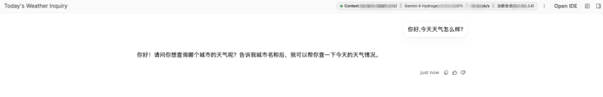
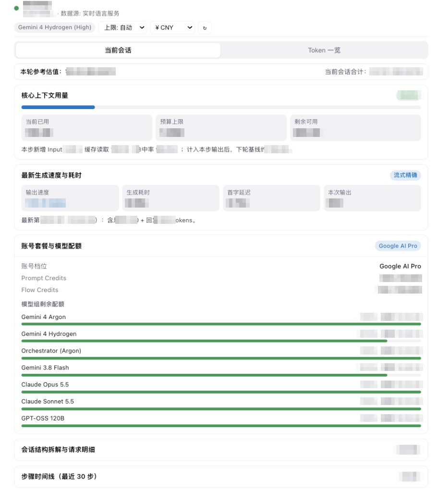
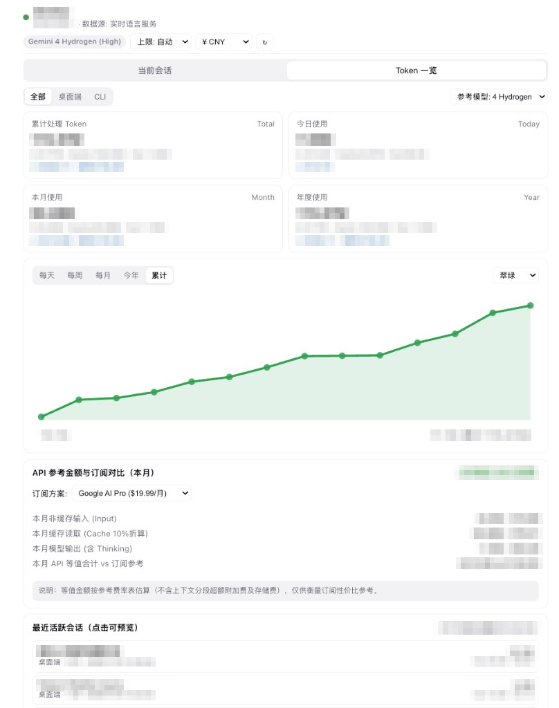
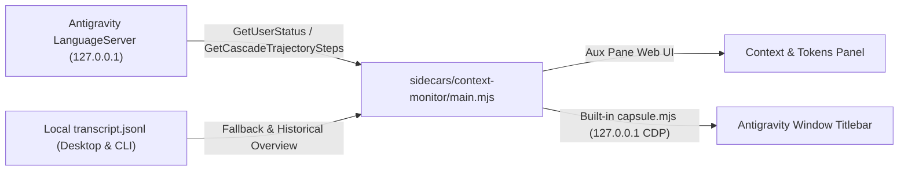

<div align="center">


# Context & Token Monitor for Antigravity

Real-time context window usage, cache hit rate, generation speed, TTFT, and Desktop/CLI token analytics right inside Antigravity.

**English** | [简体中文](./README.zh-CN.md)

[](./LICENSE)
[](https://nodejs.org/)
[](#platform-support)

</div>

---

## Preview

**Titlebar Top Capsule (Optional)**



**Sidecar Panel (`Live Session` & `Token Overview`)**

*(Note: Personal session titles and numeric values in the screenshots below are mosaicked for privacy; the UI also supports a 1-click `中文 / EN` switcher.)*

<table>
  <tr>
    <th width="50%">Live Session &amp; Model Quotas</th>
    <th width="50%">Token Overview &amp; Cost Comparison</th>
  </tr>
  <tr>
    <td valign="top"></td>
    <td valign="top"></td>
  </tr>
</table>

---

## Features

### 1. Official Sidecar Panel (`Context & Tokens`)
Runs natively in Antigravity's auxiliary pane with zero third-party runtime dependencies:
- **Live Context Budget**: Tracks active context tokens vs. window limit (`Auto`, `200K`, `983K`, `1M`, `2M`) with health indicators (`normal` / `warn >=75%` / `critical >=90%`) and next-turn baseline estimation.
- **Speed & Latency**: Measures streaming output speed (`tok/s`), total generation duration, and TTFT (Time To First Token), plus thinking vs. response token split.
- **Account & Model Quotas**: Reads active tier, Prompt/Flow credits, and remaining per-model quota percentages via local LanguageServer RPC.
- **Session Breakdown & Step Timeline**: Inspects cumulative Input / Cache Read / Output tokens, archived character distribution, and the last 30 planner steps.
- **Desktop & CLI Token Overview**: Aggregates historical `transcript.jsonl` logs across both Antigravity Desktop and CLI with:
  - 52-week daily heatmap, weekly bar chart, monthly calendar, 12-month bar chart, and cumulative curve (4 color themes).
  - Reference API cost estimation vs. subscription plans (`CNY` default + `USD`, `EUR`, `GBP`, `HKD`, `TWD`, `JPY`).
  - Clickable recent conversations list for offline preview.
- **Bilingual UI (`中文` / `EN`)**: Defaults to Simplified Chinese (`zh-CN`) and `CNY`, with an instant 1-click language & currency switcher in the top bar (persisted locally).

### 2. Titlebar Top Capsule (Enabled by Default)
Automatically injects a compact status pill into Antigravity's window titlebar (`Context: 50.0K/1.05M(4.8%) || Model Quota || 120 tok/s || Session Cost`) as soon as the plugin is enabled — **no separate background script required**. Clicking the capsule toggles the right-hand `Context & Tokens` side panel, and you can turn it off anytime using the `Capsule: On / Off` button in the side panel.

> **Architecture**: Both the side panel and the built-in titlebar capsule (`sidecars/context-monitor/capsule.mjs`) run inside the Sidecar process managed by Antigravity. The capsule connects only to Antigravity's local `127.0.0.1` Chrome DevTools port (`DevToolsActivePort`).

---

## Architecture



---

## Prerequisites

- **Antigravity** (Desktop, or Desktop + CLI)
- **Node.js >= 22.0.0** (Antigravity's built-in Sidecar runtime includes Node 24+; Node >= 22 is needed for running local tests)

---

## Installation

### Option 1: Install via Antigravity CLI (Recommended)

```bash
git clone https://github.com/llaolaol/antigravity-context-monitor.git
agy plugin install ./antigravity-context-monitor
```

### Option 2: Manual Installation

1. Clone or download this repository.
2. Copy the folder to your Antigravity global plugins directory as `context-monitor`:
   - **macOS**: `~/.gemini/config/plugins/context-monitor/`
   - **Windows**: `%USERPROFILE%\.gemini\config\plugins\context-monitor\`
3. Enable **Context & Token Monitor** on the Antigravity Customizations / Plugins page. Both the **Titlebar Top Capsule** and the **`Context & Tokens` side panel** will start automatically.

> **Upgrading from v1.0.0?** If you previously ran the old `install-top-capsule.sh` or `install-top-capsule.ps1` daemon script, run `./uninstall-top-capsule.sh` (macOS) or `.\uninstall-top-capsule.ps1` (Windows) once to remove the legacy background task.

---

### Platform Support

| Component | macOS | Windows | Linux |
| :--- | :---: | :---: | :---: |
| Official Sidecar Panel (`sidecars/context-monitor`) | Yes | Yes | Untested (expected compatible) |
| Built-in Titlebar Top Capsule (`capsule.mjs`) | Yes | Yes | Experimental (`~/.config/Antigravity`) |

---

## Privacy & Disclaimers

- **100% Local Execution**: All metrics, history aggregation, and preferences are computed and stored locally (`~/.gemini/antigravity/sidecar_data/context-monitor/`). No conversation content, usage logs, or account data ever leave your machine.
- **Reference Cost Disclaimer**: Estimated currency amounts are calculated from built-in public reference API rate tables and static exchange rates for relative comparison only. Actual billing depends on your provider plan and official invoices.

---

## Development & Testing

```bash
# Run all unit tests (Node >= 22)
npm test

# Validate Antigravity plugin manifest
agy plugin validate . --strict
```

---

## License

[MIT](./LICENSE) © 2026 llaolaol
