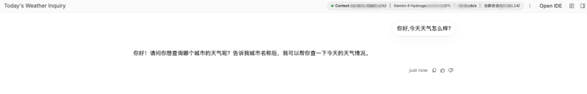
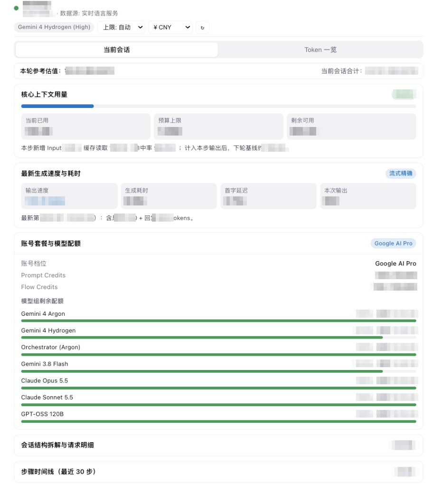
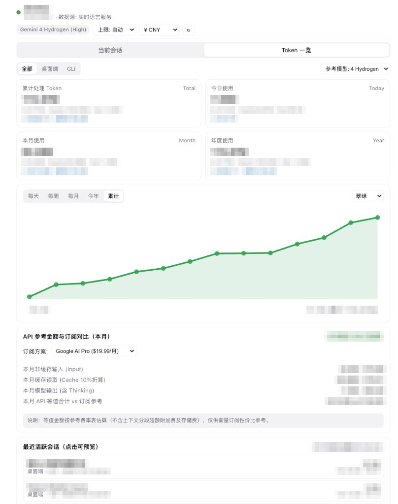
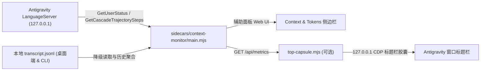

<div align="center">


# Antigravity 上下文与 Token 实时监控插件 (`Context & Token Monitor`)

在 Antigravity 客户端侧边栏与窗口顶部标题栏实时查看当前会话的上下文窗口占用、缓存命中率、生成速度、TTFT，以及桌面端与 CLI 的历史 Token 统计与参考费用对比。

[English](./README.md) | **简体中文**

[](./LICENSE)
[](https://nodejs.org/)
[](#平台支持)

</div>

---

## 界面预览

**窗口顶部状态胶囊（可选增强）**



**侧边栏监控面板（当前会话 & Token 一览）**

*（注：以下截图中的个人会话名称与具体数值已作脱敏马赛克处理；实际面板右上角支持一键切换 `中文 / EN`。）*

<table>
  <tr>
    <th width="50%">当前会话监控与模型配额</th>
    <th width="50%">Token 一览与订阅对比</th>
  </tr>
  <tr>
    <td valign="top"></td>
    <td valign="top"></td>
  </tr>
</table>

---

## 核心功能

### 1. 官方 Sidecar 侧边栏面板 (`Context & Tokens`)
零第三方运行时依赖（仅依赖 Node.js 内置模块与 Antigravity `sidecar_sdk`），原生集成于客户端辅助面板：
- **核心上下文用量**：实时追踪当前对话已用 Token 与窗口上限（支持 `自动` / `200K` / `983K` / `1M` / `2M`），带健康状态警示（正常 / `≥75%` 偏高 / `≥90%` 临近上限）与下轮基线预估。
- **生成速度与首字延迟**：实时计算流式输出速度（`tok/s`）、总耗时与 TTFT（首字延迟），并区分思考 Token（Thinking）与正文回复 Token。
- **账号套餐与模型配额**：通过本机 LanguageServer RPC 读取当前套餐档位、Prompt/Flow Credits 以及各模型组剩余配额百分比与重置时间。
- **会话拆解与步骤时间线**：展示服务端累计 Input / Cache Read / Output、本地归档字符分布，以及最近 30 步模型请求时间线。
- **桌面端 + CLI 全局 Token 一览**：自动聚合桌面端与 CLI 的历史 `transcript.jsonl` 日志：
  - 提供 52 周每日热力图、周柱状图、月度日历、年度 12 月柱状图及累计曲线（支持 4 套配色主题）。
  - 支持 API 参考等值金额与订阅套餐（Google AI Plus / Pro / Ultra / 自定义实付）对比。
  - 默认币种为 **人民币 (`CNY`)**，支持切换 `USD / EUR / GBP / HKD / TWD / JPY`。
  - 支持点击最近活跃会话进行离线历史预览。
- **中 / 英双语切换**：默认界面语言为**简体中文**，顶部工具栏支持一键切换 **中文 / EN** 并持久化保存。

### 2. 可选标题栏顶部状态胶囊 (`top-capsule.mjs`)
可选增强守护脚本，在客户端顶部标题栏注入紧凑胶囊条（`Context: 已用/上限(百分比) || 模型配额 || 输出速度 || 当前会话合计`），悬停显示详细统计，点击可一键展开/收起右侧 `Context & Tokens` 面板。

> **架构说明**：侧边栏面板基于官方 Sidecar SDK 运行；顶部胶囊为**可选增强功能**，通过读取本机 `127.0.0.1` 的 `DevToolsActivePort` 向窗口标题栏注入 UI。

---

## 架构概览



---

## 环境要求

- **Antigravity 客户端**（支持桌面端，并可同时统计 CLI 会话）
- **Node.js >= 22.0.0**（用于支持原生全局 `WebSocket` 与 `AbortSignal.timeout`）

---

## 安装方式

### 方式一：通过 Antigravity CLI 一键安装（推荐）

```bash
git clone https://github.com/llaolaol/antigravity-context-monitor.git
agy plugin install ./antigravity-context-monitor
```

### 方式二：手动拷贝安装

1. 克隆或下载本仓库源码。
2. 将仓库目录复制（或软链接）到全局插件目录并命名为 `context-monitor`：
   - **macOS**：`~/.gemini/config/plugins/context-monitor/`
   - **Windows**：`%USERPROFILE%\.gemini\config\plugins\context-monitor\`
3. 在 Antigravity 插件管理页面确认已启用 **Context & Token Monitor**，点击打开 `Context & Tokens` 侧边栏即可使用。

---

## 可选：启用顶部标题栏胶囊

顶部胶囊会监听本机 `DevToolsActivePort` 并在窗口标题栏展示摘要胶囊。

### macOS

```bash
chmod +x install-top-capsule.sh uninstall-top-capsule.sh
./install-top-capsule.sh
```

卸载并关闭 LaunchAgent：

```bash
./uninstall-top-capsule.sh
```

### Windows (PowerShell)

```powershell
powershell -ExecutionPolicy Bypass -File .\install-top-capsule.ps1
```

卸载并清理计划任务：

```powershell
powershell -ExecutionPolicy Bypass -File .\uninstall-top-capsule.ps1
```

### 平台支持

| 组件 | macOS | Windows | Linux |
| :--- | :---: | :---: | :---: |
| 官方 Sidecar 面板 (`sidecars/context-monitor`) | 支持 | 支持 | v1.0 暂未实测 |
| 顶部胶囊脚本 (`top-capsule.mjs`) | 支持 | 支持 | v1.0 暂未适配 |
| 自启安装脚本 (`install-top-capsule.*`) | 支持 (`launchd`) | 支持 (Windows 计划任务) | — |

---

## 隐私安全与免责声明

- **100% 本地运行**：所有统计计算、日志扫描与偏好配置均在本地完成（偏好与运行日志保存在 `~/.gemini/antigravity/sidecar_data/context-monitor/`），不会向任何外部服务器上传您的对话记录、Token 数据或账号信息。
- **参考金额声明**：界面中的金额估算基于内置公开 API 参考单价与静态汇率换算，仅用于消费趋势与订阅性价比的横向对比参考，不代表实际账单结算金额。

---

## 本地开发与测试

```bash
# 运行全部单元测试（需 Node.js >= 22）
npm test

# 使用官方 CLI 严格校验插件清单
agy plugin validate . --strict
```

---

## 开源协议

[MIT](./LICENSE) © 2026 llaolaol
